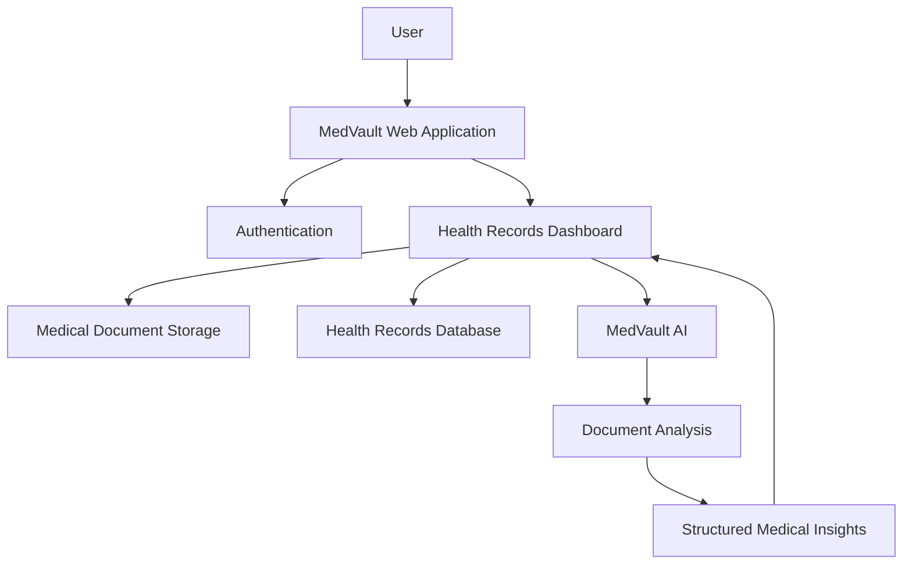

# 🏥 MedVault
### Your Health. Your Records. One Secure Vault.

<p align="center">
  <strong>A unified digital space for managing, organizing, and understanding personal healthcare records.</strong>
</p>

<p align="center">
  
  
  
  
</p>

---

## ✦ About MedVault

Healthcare information is often scattered across different hospitals, laboratories, prescriptions, diagnostic centres, and paper documents. Finding the right medical record at the right time shouldn't be complicated.

**MedVault** aims to bring these records together in one organized digital space.

It is a healthcare record management platform designed to help individuals maintain, access, and manage their medical information through a centralized personal health vault.

From storing medical documents to revisiting previous reports, MedVault focuses on making personal healthcare information more accessible, organized, and easier to manage.

> **One place for your medical history. A clearer picture of your healthcare journey.**

## ✨ Core Vision

MedVault is built around three principles:

| Principle | What it means |
|---|---|
| 🔐 Privacy | Personal health information deserves careful handling and access control. |
| 📂 Organization | Medical records should be structured and accessible instead of scattered. |
| 🧠 Intelligence | Technology can help make complex medical information easier to understand. |

## 🚀 What MedVault Offers

- **Personal Health Vault** — A centralized space for maintaining personal medical records.
- **Medical Document Management** — Upload and manage supported medical documents.
- **Secure Authentication** — User authentication and account-based access.
- **Cloud Storage** — Store medical documents using private cloud storage.
- **Health Record Dashboard** — Access and review your health information through a unified interface.
- **AI-Powered Capabilities** — An evolving intelligence layer designed to help users understand their medical documents.

*Features and availability may evolve as the platform develops.*

## 🧩 The MedVault Ecosystem

MedVault is designed as a broader healthcare platform, with specialized capabilities that can extend its core record-management experience.

### 1. MedVault — The Foundation

The original MedVault experience provides the foundation:

- Personal health-record organization
- Medical document storage
- User authentication
- Centralized access to health information
- A foundation for future healthcare capabilities

### 2. MedVault AI — The Intelligence Layer

**MedVault AI is an AI-powered extension within the MedVault ecosystem.**

It builds on the foundation of personal medical records by introducing intelligent document analysis and easier interpretation of medical information.

Its capabilities include:

- **Medical Report Analysis** — Extract and interpret information from supported medical reports.
- **Structured Information Extraction** — Organize relevant medical findings into readable information.
- **Report Summaries** — Present key observations in a more understandable format.
- **Reference-Range Awareness** — Help users review measurements alongside the reference ranges printed in their reports.
- **Health Insights** — Highlight observations that may deserve further attention.
- **Doctor Discussion Support** — Help users prepare questions for their healthcare professionals.

The goal is not to replace medical professionals. It is to make the information patients already have easier to understand and review.

> **MedVault stores and organizes your health information. MedVault AI helps you make more sense of it.**

## 🏗️ Technology Stack

| Layer | Technology |
|---|---|
| Frontend | Next.js, React |
| Styling | Tailwind CSS |
| Backend Services | Next.js API routes, Supabase Edge Functions |
| Authentication | Supabase Auth |
| Database | Supabase PostgreSQL |
| File Storage | Supabase Storage |
| AI Integration | Google Gemini API |
| Mobile Foundation | Capacitor |

## 🔍 Architecture Overview

MedVault follows a modular architecture in which the application interface, authentication, database, document storage, and AI processing responsibilities are separated.



### Privacy & Security

Healthcare data requires special care. MedVault uses account-based authentication, private document storage, and database access policies to help protect personal records.

- Supabase Row Level Security (RLS)
- Private medical document storage
- User-scoped record access
- Server-side handling of sensitive API credentials

**Important:** MedVault AI provides informational assistance, not medical diagnosis or treatment. AI-generated information should always be reviewed with a qualified healthcare professional.

## ⚙️ Getting Started

### Prerequisites

Make sure you have the following installed:

- Node.js (20 or later recommended)
- npm
- Git
- A Supabase project

### 1. Clone the repository

```bash
git clone https://github.com/puneet2946/MedVault.git
cd MedVault
```

### 2. Navigate to the application

```bash
cd medvault_patient
```

### 3. Install dependencies

```bash
npm install
```

### 4. Configure environment variables

Create a `.env.local` file inside `medvault_patient`:

```env
NEXT_PUBLIC_SUPABASE_URL=your_supabase_project_url
NEXT_PUBLIC_SUPABASE_PUBLISHABLE_KEY=your_supabase_publishable_key

GEMINI_API_KEY=your_gemini_api_key
GEMINI_MODEL=gemini-2.5-flash
```

Use the variables required by the features you enable. Keep secret keys server-side and never commit `.env.local` to Git.

### 5. Start the development server

```bash
npm run dev
```

Open your browser and visit:

```text
http://localhost:3000
```

## 📁 Project Structure

```text
MedVault/
│
├── medvault_patient/
│   ├── app/                    # Next.js application routes
│   ├── components/             # Reusable UI components
│   ├── lib/                    # Shared utilities and services
│   ├── public/                 # Static assets
│   ├── supabase/
│   │   ├── functions/          # Supabase Edge Functions
│   │   └── migrations/         # Database migrations
│   ├── .env.example            # Environment template, if maintained
│   ├── package.json
│   └── next.config.mjs
│
└── README.md
```

*The structure above is a high-level guide; consult the repository for the exact current file layout.*

## 🛣️ Roadmap

MedVault is an evolving project. Its broader direction includes:

- [x] Establish the core MedVault application
- [x] Set up authentication and cloud infrastructure
- [x] Build the medical document management foundation
- [x] Introduce MedVault AI capabilities
- [ ] Continue improving the health-record experience
- [ ] Expand intelligent health-document workflows
- [ ] Improve mobile accessibility
- [ ] Explore additional integrations and healthcare workflows

## 🌱 The Bigger Picture

MedVault is more than a place to upload medical documents.

The long-term vision is to create a connected personal healthcare ecosystem where individuals can maintain their medical history, access their records, and use intelligent tools to better understand their health information.

As the platform evolves, MedVault will continue to bring together secure record management and useful healthcare technology under one roof.

---

## 🤝 Contributing

Contributions, ideas, and feedback are welcome.

1. Fork the repository.
2. Create a feature branch.
3. Make your changes.
4. Commit your work.
5. Open a Pull Request.

For major changes, consider opening an issue first to discuss the proposed improvement.

## ⚠️ Disclaimer

MedVault is a technology project intended for personal health-record management and informational assistance. It is not a substitute for professional medical advice, diagnosis, or treatment. Always consult a qualified healthcare professional regarding medical decisions.

## 📜 License

See the repository's `LICENSE` file for licensing information.

---

<p align="center">
  <strong>MedVault</strong>
  <br/>
  <em>Your health records, brought together.</em>
  <br/><br/>
  Built with care. Designed for a healthier, more informed future.
</p>
